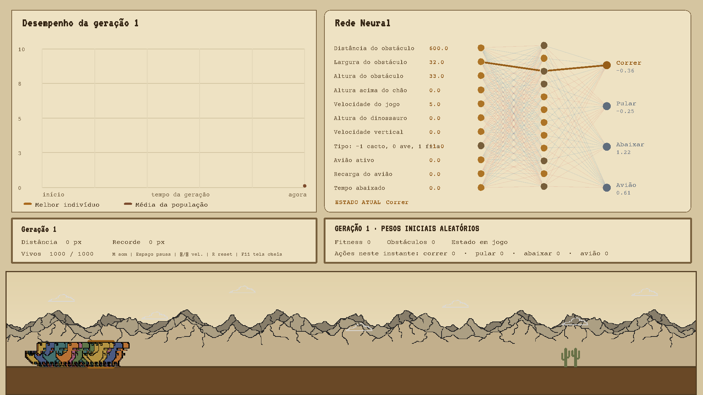

# Dino Neural Network — Java

Aplicação desktop Java Swing que treina uma população de dinossauros para evitar obstáculos por neuroevolução. Cada agente executa sua própria rede neural. A simulação mostra o mundo, as ativações da rede e as métricas da população.

## Requisitos e execução

É necessário JDK 17 ou superior e ambiente gráfico compatível com Swing. O projeto não tem dependências externas Java.

Na raiz do repositório, compile e execute:

```bash
mkdir -p out
javac -d out src/main/java/br/com/dinossauro/*.java
java -cp out br.com.dinossauro.DinoNeuralApp
```

Sprites e fontes são carregados por caminhos relativos à raiz. Execute o comando a partir dessa pasta. Em ambientes sem interface gráfica é possível compilar e rodar o teste do roteiro, mas não abrir a janela Swing.

## Controles

- `Espaço`: pausar ou retomar.
- `Seta para cima` e `Seta para baixo`: aumentar ou diminuir a velocidade de exibição, de 1× até 8×.
- `M`: ligar ou desligar música e efeitos.
- `R`: reiniciar o treinamento.
- `F11`: alternar entre tela cheia e janela.

A janela é redimensionável. O painel mantém uma área lógica de 1200 × 678 pixels e a escala proporcionalmente, com margens se necessário. O cenário é recortado à área útil da moldura e o piso usa preenchimento sépia uniforme, evitando que sprites excedam a borda ou deixem uma emenda de duas cores. A interface usa papel envelhecido, sépia e âmbar, com VT323 nos títulos e Courier Prime em textos menores. Fontes e licenças estão em `assets/fontes/`.



## Organização do projeto

- `DinoNeuralApp.java`: cria a janela e inicializa a interface e o treinador.
- `Trainer.java`: mantém a população, executa física e colisões, calcula fitness e produz gerações.
- `NeuralNetwork.java`: implementa a MLP, a propagação direta, cópia de genomas, cruzamento e mutação.
- `Dino.java`: guarda a rede individual, estado físico, recarga, pontuação e estado de vida.
- `Obstacle.java`: representa tipo, posição, dimensões e caixa de colisão de cada obstáculo.
- `ObstacleGenerator.java`: fornece o roteiro cíclico determinístico do mundo.
- `GamePanel.java`: desenha simulação, gráficos, rede, estatísticas e controles Swing.
- `SoundEngine.java`: sintetiza música e efeitos com `javax.sound.sampled`.
- `src/test/java/br/com/dinossauro/ObstacleGeneratorDeterminismTest.java`: teste executável da repetibilidade do roteiro.
- `assets/imagens/`: sprites do jogo.
- `assets/fontes/`: fontes da interface e licenças.
- `docs/preview.gif`: demonstração original.
- `releases/`: arquivos compactados preservados do material recebido; não são necessários para compilar o código-fonte.

## Simulação e mundo

O treinador mantém 1.000 agentes. Cada episódio inicia na velocidade de 5 px por tick, repõe a população e reinicia o roteiro. A velocidade aumenta com a distância até o limite de 12 px por tick. O episódio termina quando todos os agentes colidem. A velocidade de exibição determina quantos ticks são executados por atualização gráfica; ela não muda as regras de um tick.

O roteiro possui 16 posições definidas em código e se repete ciclicamente. Cada posição define tipo, sprite, altura e intervalo livre após o obstáculo. Há cactos simples de vários tamanhos, pássaros baixos, médios e altos e fileiras largas de cactos. A distância entre os pontos de surgimento foi reduzida para 80% da original, aumentando em 25% a frequência; foi aplicado mais um aumento de 10% sobre a frequência atual. O maior vão livre, que era de 1.638 px, foi reduzido em 20% para 1.310 px. Para sequências em que dois obstáculos consecutivos exigem salto, há ao menos 540 px entre seus inícios, dando tempo para aterrissar antes do próximo. O roteiro volta ao mesmo ponto no início de cada episódio. A escolha e os intervalos não usam números aleatórios.

As alturas dos pássaros correspondem às ações permitidas pelo treinador: o pássaro baixo admite salto; o médio admite abaixar; o alto passa acima da caixa de colisão normal do dinossauro. Cactos comuns permitem salto. Fileiras largas usam o comando de avião, ativo por 70 ticks, seguido por recarga de 150 ticks. Mesmo com o espaçamento reduzido, as fileiras largas continuam separadas por pelo menos 1.800 px entre seus inícios, o suficiente para a recarga terminar à velocidade máxima de 12 px/tick. O treinador oferece o comando de avião para as fileiras largas; não oferece salto para esse tipo de obstáculo.

A população inteira de 1.000 dinossauros aparece desde o início como uma única massa contínua e muito compacta no campo de jogo. Cada agente recebe uma posição X distinta, amostrada uniformemente em uma faixa curta entre x=40 e x=180, com semente fixa; os agentes não são ordenados por posição, e o teste garante que a maior diferença entre vizinhos na ordenação por X seja menor que a largura de um sprite. Assim, os corpos se sobrepõem intensamente, sem ilhas ou vãos entre grupos. Todos começam e são desenhados na mesma altura do chão; não há deslocamento artificial no eixo vertical. O primeiro obstáculo fica em x=960, depois da multidão, e nenhum agente começa atravessando um obstáculo. Essa disposição se repete entre gerações para permitir comparação, enquanto os pesos iniciais das redes continuam aleatórios. O percurso também é determinístico e gera obstáculos adiante do agente mais distante à medida que a simulação avança, evitando que um sobrevivente fique correndo em uma pista vazia. Os 1.000 agentes continuam sendo simulados, inclusive os que morrem e os cujos sprites ficam parcialmente cobertos pela multidão.

## Rede neural

A topologia atual é uma MLP totalmente conectada `11–12–4`: onze entradas, doze neurônios ocultos e quatro saídas. As entradas descrevem distância, largura, altura e posição vertical do próximo obstáculo; velocidade do jogo; altura e velocidade vertical do dinossauro; categoria do obstáculo; estado e recarga do avião; e tempo restante abaixado. Os valores são normalizados.

Cada neurônio calcula a soma ponderada das ativações anteriores mais um viés:

\[
z_j^{(l)} = b_j^{(l)} + \sum_i w_{ji}^{(l)} a_i^{(l-1)}
\]

Na camada oculta, aplica-se a tangente hiperbólica:

\[
a_j^{(l)} = \tanh(z_j^{(l)})
\]

A função `tanh` comprime os valores para o intervalo de −1 a 1. A camada de saída mantém valores lineares. As quatro saídas representam preferência por correr, pular, abaixar ou usar o avião. O treinador escolhe a maior saída entre as ações permitidas para aquele obstáculo e estado físico.

Todos os pesos e vieses de todas as camadas, inclusive a camada de saída, começam aleatórios, limitados pela escala de Xavier/Glorot. Não há política inicial imposta: na geração 1, redes diferentes podem preferir ações diferentes. O treinador ainda restringe as ações que não fazem sentido ou não estão disponíveis naquele estado; por isso, um agente só pode saltar, abaixar ou usar o avião quando as condições do obstáculo e as recargas permitem. O cruzamento e a mutação genética alteram os genomas nas gerações seguintes. Os parâmetros são pesos e vieses guardados em matrizes por camada. Para 11–12–4 são `12 × (11 + 1) + 4 × (12 + 1) = 196` parâmetros. A cópia preserva parâmetros; o cruzamento escolhe para cada parâmetro o valor de um dos pais; a mutação soma ruído gaussiano a alguns parâmetros e limita cada valor ao intervalo −5 a 5.

O método `train` da classe implementa uma atualização por retropropagação com erro quadrático. Ele não é chamado pelo treinador. O aprendizado da população acontece pela evolução das redes, não por treinamento supervisionado nem por retropropagação a cada tick.

### Forward Propagation

A propagação direta (*forward propagation*) copia as onze entradas para a camada de entrada. Para cada camada seguinte, multiplica ativações pelos pesos, soma o viés e aplica `tanh` à camada oculta. A camada final produz quatro valores lineares. Esse processo calcula uma decisão e não atualiza pesos. Os pesos mudam entre gerações por cruzamento e mutação.

## Fitness e evolução

A cada tick vivo, o agente recebe `0,05 × velocidade` pontos. Uma ação de salto, abaixar ou avião tem pequeno custo para desencorajar acionamentos desnecessários. Ao ultrapassar um obstáculo, recebe 25 pontos. Uma colisão encerra o agente e aplica −100 pontos naquele tick. O fitness é a soma dessas recompensas durante o episódio.

Ao final do episódio, os agentes são ordenados por fitness. O melhor genoma histórico é preservado e outros indivíduos de elite são copiados até completar quatro posições. Os descendentes são produzidos por seleção de torneio entre os 20% mais bem classificados, cruzamento dos parâmetros e mutação gaussiana. Em condições normais, a mutação ocorre com taxa de 12% e desvio padrão de 0,12. Cerca de 5% da população são indivíduos novos, inicializados aleatoriamente.

A geração 1 não é uma política treinada ou neutra: ela é uma população de redes com pesos aleatórios, cujas preferências variam entre indivíduos. A posição em fila e o roteiro são repetidos entre gerações, mas cada slot começa em um ponto físico diferente do percurso. A partir da geração 2, elites preservadas e descendentes produzidos por cruzamento e mutação são selecionados pelo fitness; essa seleção tende a favorecer os genomas que sobrevivem e acumulam mais pontos. O treinador acompanha o maior fitness por geração. Após oito gerações sem novo máximo, a mutação aumenta para 20%, o desvio padrão passa a 0,20 e os novos indivíduos passam a 10% da população. Um novo máximo zera o contador de estagnação.

## Interface e indicadores

A tela apresenta as curvas de fitness melhor e médio na geração, o diagrama da MLP com pesos e ativações, a ação selecionada, agentes vivos, distância percorrida e recorde da sessão. A população e o mundo animado aparecem na área de jogo. Música e efeitos são sintetizados em tempo real; não são necessários arquivos de áudio.

## Testes

O teste do roteiro não depende de JUnit. Na raiz do projeto, execute:

```bash
mkdir -p out
javac -d out src/main/java/br/com/dinossauro/*.java src/test/java/br/com/dinossauro/ObstacleGeneratorDeterminismTest.java
java -cp out br.com.dinossauro.ObstacleGeneratorDeterminismTest
```

O teste confere que as redes iniciais têm saídas variadas sob uma entrada comum, que os 1.000 agentes têm posições X únicas, irregulares e reproduzíveis dentro da tela, que formam um único bloco sem intervalos do tamanho de um sprite, começam na mesma altura e ficam fora dos obstáculos, que já há ações especiais no primeiro tick quando elas estão disponíveis e que o roteiro continua à frente do agente mais distante. Também compara 48 obstáculos de duas instâncias após reset, verifica os tipos previstos, confirma o aumento adicional de frequência, o limite máximo de 1.310 px para o vão livre e pelo menos 540 px entre obstáculos consecutivos que exigem salto, e valida distância mínima de 1.800 px entre fileiras largas, correspondente a 150 ticks na velocidade máxima de 12 px/tick.

## Resultados e limitações

A comparação focada em consistência foi feita sobre duas sequências consecutivas de 48 obstáculos, reiniciadas a partir da mesma origem. Na geração inicial, todos os pesos são aleatórios; o teste confirma diversidade de saídas, mas não mede vitória nem velocidade de convergência. No gerador da versão recebida, as 48 entradas diferiram entre dois resets; no gerador atualizado, 0 de 48 diferiram. O teste automatizado confirma o segundo resultado. A distribuição pseudoaleatória dos agentes é fixa entre gerações para comparação justa, mas os diferentes indivíduos ainda começam a distâncias diferentes dos obstáculos; por isso, o fitness pode refletir tanto a estratégia quanto a posição ocupada. A interface aceita redimensionamento e tela cheia, e a mutação aumenta durante estagnação.

Não há benchmark estatístico antes/depois integrado, nem resultado numérico confiável de taxa de vitória ou gerações necessárias para aprender. A versão original não registrava sementes nem resultados por execução. Uma comparação justa de desempenho exigiria executar várias sementes genéticas e comparar a mesma métrica. A aleatoriedade dos genomas e dos operadores evolutivos continua presente, então uma execução isolada não prova melhora geral.

A rede permanece com topologia fixa. A camada oculta adicional não foi implementada: sem uma medição comparativa, isso aumentaria parâmetros e espaço de busca sem evidência de que a capacidade da rede atual seja o gargalo. A retropropagação continua disponível na classe, mas não integra o treinamento. Os gráficos são apenas visuais e não salvam resultados em disco. O teste valida repetibilidade do roteiro e da distribuição inicial, não prova formalmente que toda rede aleatória consiga superar todo cenário.

## Referências

- Stanley et al., [Designing neural networks through neuroevolution](https://www.nature.com/articles/s42256-018-0006-z), *Nature Machine Intelligence*, 2019. Revisão de neuroevolução, exploração populacional, diversidade e busca de arquitetura.
- Stanley e Miikkulainen, [Evolving Neural Networks through Augmenting Topologies](https://nn.cs.utexas.edu/downloads/papers/stanley.cec02.pdf), 2002. Artigo original do NEAT, que usa marcações históricas e especiação para preservar diversidade quando topologias evoluem.
- [dusanerdeljan/neuroevolution-dino](https://github.com/dusanerdeljan/neuroevolution-dino). Exemplo de Chrome Dino com redes pequenas e algoritmo genético.
- [edwarddn/dinosaur-edward-game](https://github.com/edwarddn/dinosaur-edward-game). Jogo Dino em Java que também descreve treinamento genético.
